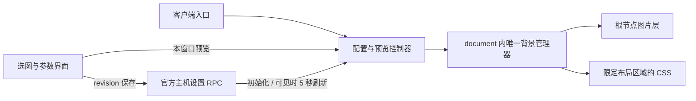

# Paseo 背景插件实现

2026-10-23。面向桌面和 Web，实际验收版本为 Paseo `0.13.0-beta.1`。不修改 Paseo 源码、安装文件或 SDK，不新增宿主接口；原生移动端不注册插件。

## 接入方式

Paseo 尚无公开的全局图片背景贡献接口。本项目通过已有插件入口加载，在桌面和 Web 的浏览器环境中插入图片层，并为已识别的布局区域添加作用域 CSS。它依赖宿主内部布局，需要随 Paseo 版本维护适配。

`index.client.tsx` 先检查 `Platform.OS === "web"`，创建独立于页面的控制器，再注册设置页、带滚动容器的侧边栏页面，以及打开设置 / 切换背景的 Command Center 项目。入口返回统一清理函数。

`index.server.ts` 只通过 `server.registerSettings` 注册主机配置。配置的读取、写入和修订冲突使用官方 `defineSettings` / `settingsRpc` / `client.rpc`，无需自定义服务或新增网络端口。



## 界面与配置

设置页使用宿主的 React、React Native 和设置组件。四个滑块由 `client/web.ts` 封装浏览器范围控件，提供键盘和无障碍标签。设置与侧边栏入口共享同一控制器，页面未打开时背景仍可恢复。

```ts
interface BackgroundSettings {
  enabled: boolean;
  profileId: string;
  source: { kind: "preset"; id: string } | { kind: "url"; url: string };
  imageOpacity: number;   // 0..1，默认 0.65
  surfaceOpacity: number; // 0..1，默认 0.72
  blurRadius: number;     // 0..24px，默认 0
  brightness: number;     // 0.4..1.4，默认 1
  fit: "cover" | "contain";
  position: "center" | "top" | "bottom" | "left" | "right";
}
```

配置默认关闭，默认来源为内置的 `forest`。六张预设由本项目代码生成 SVG data URI，无外部图片依赖。自定义来源仅接受 HTTPS URL；图片地址通过元素属性赋值，不拼接进 CSS。

设置采用 `scope: "host", version: 1`。保存时携带打开草稿时的 revision，冲突则保留草稿并显示重新读取入口；重新读取会放弃草稿并加载最新保存值。损坏的配置保留 revision，以便用默认值修复。

拖动只更新当前窗口的草稿。保存成功立即应用；同一主机的其他可见客户端约每 5 秒刷新，重新聚焦或恢复可见时立即读取。取消、离开页面或卸载时释放预览。读取请求不能覆盖更晚完成的写入。

首次保存生成稳定的 `profileId`。同一 document 的多主机实例共享一个背景管理器；本窗口预览临时优先，保存或明确选择主机后将来源偏好记入 localStorage。所选来源退出时恢复原界面，不自动改用另一台主机。

## 图片层与布局适配

图片层固定覆盖视口，置于应用内容之后，设置 `pointer-events: none` 和 `aria-hidden`。透明度、模糊、亮度和位置只作用于图片。模糊时扩展图片边缘以减少露底，新图片解码成功后才替换旧图。20 秒加载超时、解码失败和缺少布局区域均反馈到设置页；换图失败保留已加载图片。

适配器以已核对的 `data-testid` 为锚点，包括工作区、左右侧栏、标签栏、会话滚动区、输入框根部和本插件设置页面。沿锚点祖先读取原生主题底色，布局表面设为透明，图片上方仅保留一层固定的主题底色，其 alpha 对应 `surfaceOpacity`。这样聊天与输入框周围不会因路径深度不同产生色带，嵌套布局也不会叠加 alpha。

布局路径包含 36px 的标题栏和标签栏，跳过边线、按钮和输入控件。右侧栏还会沿大尺寸布局容器寻找首个滚动视口，跨过无尺寸的 `display: contents` 容器，支持没有固定测试标识的插件面板；找到视口后不继续进入卡片和行内容，遇到编辑器、终端、画布或文本编辑区则停止。文字、图标、卡片、菜单、弹窗和嵌入内容保留原有样式。

每个目标节点仅添加插件专有标记，样式集中在插件自己的 style 节点。清理时恢复原标记、移除自己的图片和样式，不整段回写 React 的 style，保留宿主期间发生的主题与布局更新。

MutationObserver 限定在应用根部，利用浏览器已有的批量通知，在微任务检查点完成适配，不再使用 100ms 的延迟。记录全部布局祖先，提前登记隐藏面板的滚动视口，保留已访问的隐藏工作区标记和已加载图片。ResizeObserver 监听锚点尺寸，处理布局稍后确定或仅尺寸变化的情况，并在清理时释放。样式是固定的作用域规则；测量时临时关闭颜色覆盖，在同一任务内读取主题、更新标记后恢复，不在浏览器绘制间隙移除覆盖。忽略自己的图层、范围控件、流式文字以及滚动视口内的普通内容更新。窗口聚焦时检查根节点是否重建。

关闭、图片强度为 0 或最后一个实例释放时移除覆盖。异步请求带 generation，旧解码结果不能重新创建已关闭的图层；清理图片超时、刷新定时器、观察器和事件监听器，并移除空的全局管理器。清理可重复调用。

## 目录

```text
index.client.tsx          平台检查、入口与清理
index.server.ts           注册主机设置
client/controller.ts      读取、CAS 保存、预览与轮询
client/web.ts             浏览器类型边界、图片层、布局适配
client/settings-screen.tsx 中英双语选择与参数界面
shared/settings.ts        Zod 配置及颜色 alpha 处理
shared/presets.ts         六张本地矢量风景
tests/                    配置、控制器和生命周期回归
scripts/                  原版 Web / 桌面完整验证
verification/installed/   截图与去除连接信息的结果
```

客户端主类型检查不启用 DOM lib，浏览器调用的最小类型集中在 `client/web.ts`。生产包只依赖宿主提供的模块，无安装构建命令。

## 验收与边界

实际安装已在原版 macOS 应用（Electron 44.2.0）及对应的 HTTP Web UI 中通过，包含参数、持久化、同步冲突、深浅主题和完整清理；另有 20 项回归检查。初版证据见 [安装验收](verification/INSTALLED.md)，v0.1.1 的反复及快速 workspace 切换证据见 [修复验收](verification/workspace-switch/README.md)，v0.1.2 的聊天布局合成透明度证据见 [透明度验收](verification/chat-opacity/README.md)，v0.1.3 的逐帧与区域覆盖证据见 [连续性验收](verification/coverage/README.md)。早期未封装插件的渲染原型保留供调研，不能作为当前版本的安装证据。

本版本不提供本地文件上传、轮播、视频、按工作区配置或系统窗口透明；Windows / Linux 尚未实测。长会话流式性能和大图长期内存需要单独压测。后续新增本地导入时，应明确本机存储与主机同步策略，不把 daemon 文件路径直接暴露为客户端资源。

## 依据

- [官方插件文档](https://paseo.sh/zh-CN/docs/plugins.md)
- [客户端公开契约](https://github.com/getpaseo/paseo/blob/3fa625701eae6b3a07ccae18299200b1a7cf2776/packages/plugin/src/client/contracts.ts)
- [客户端执行环境](https://github.com/getpaseo/paseo/blob/3fa625701eae6b3a07ccae18299200b1a7cf2776/packages/app/src/plugins/evaluate.ts)
- [会话 Web 滚动区](https://github.com/getpaseo/paseo/blob/3fa625701eae6b3a07ccae18299200b1a7cf2776/packages/app/src/agent-stream/strategy-web.tsx#L1316)

源码依据固定到 `v0.13.0-beta.1` 提交，版本范围不能替代实际布局验收。
