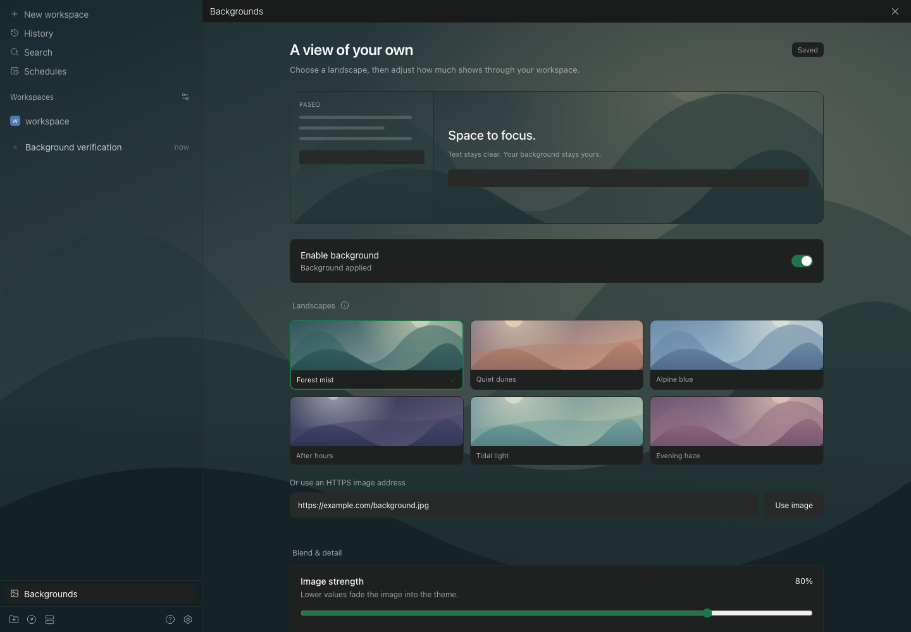
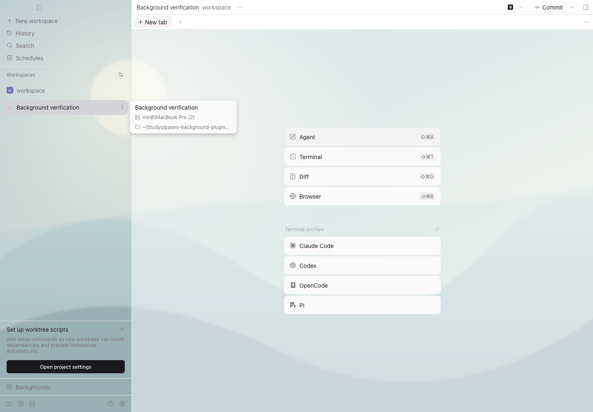

# Paseo Backgrounds

为 Paseo **桌面和 Web** 选择背景，独立调整图片强度与界面底色透明度。使用现有插件接口加载，无需修改 Paseo 源码或安装文件。



## 功能

- 六张随插件提供的矢量风景，以及自定义 HTTPS 图片地址。
- 图片强度、界面底色、模糊、亮度、覆盖 / 完整显示和五种位置。
- 即时预览、保存、取消预览、恢复默认值；离开页面自动结束未保存预览。
- 保存到当前主机，连接同一主机的客户端自动同步；并发保存提供冲突提示。
- 侧边栏、设置页和 Command Center 入口，中英双语。
- 随深浅主题调整底色；关闭或停用后还原界面。



## 兼容性

已在 **Paseo 0.13.0-beta.1** 的原版 macOS 桌面应用和同版本 Web 客户端中实测。插件声明支持 `>=0.13.0-beta.1 <0.14.0`，后续版本的内部布局仍可能需要适配。

公开站点 `app.paseo.sh` 在本次验收时仍是 v0.12.0。Web 使用者需要支持 v0.13 插件接口的客户端；只升级 daemon 不会升级浏览器中的 UI。Windows / Linux 桌面使用同一 Web 渲染实现，本版本尚未在这些系统实测。原生移动端不注册本插件。

背景覆盖已适配的工作区、会话布局、侧边栏和插件页面。菜单、弹窗、输入控件、代码编辑器、终端及嵌入网页保留各自的底色。这里调节的是应用内部背景，不能使操作系统窗口透明。

## 安装

在目标主机启用 Paseo 插件功能后运行：

```sh
paseo plugin add git:MinLeeV5/paseo-background-plugins --ref v0.1.1
paseo plugin ls paseo-background
```

`git:` 前缀用于指定 Git 仓库。插件运行 ID 是 `paseo-background`。安装不需要手动执行 `npm install`，依赖由 Paseo 提供。

已有安装可更新到修复 workspace 切换问题的版本：

```sh
paseo plugin update paseo-background --ref v0.1.1
```

安装后，点击侧边栏的 **背景 / Backgrounds**，选择背景并点击 **保存背景**。也可以在设置的主机插件区域打开背景设置，或在 Command Center 搜索 `background`、`背景`。

新安装默认关闭背景；选择预设会开启本机预览，保存后其他客户端可在约 5 秒内同步。预览只影响当前窗口；保存值属于当前连接主机。多主机同时提供背景时，可以在设置中选择当前设备使用的主机。

自定义图片填写可以直接返回图片内容的 HTTPS 地址。图片由客户端加载；不要填写 daemon 上的本地文件路径。首版提供预设和地址选择，本地图片上传、轮播和视频背景尚未提供。

```sh
# 暂停插件并清理注入的背景
paseo plugin disable paseo-background

# 恢复插件及已保存设置
paseo plugin enable paseo-background

# 移除插件注册
paseo plugin remove paseo-background
```

Paseo 是否保留卸载后的设置由宿主决定；停用和移除不会修改已有工作区文件。

## 开发与验证

```sh
npm ci --ignore-scripts
npm run check
npm run pack:check
paseo plugin add /absolute/path/to/paseo-background-plugins
paseo plugin reload paseo-background
```

`npm run check` 包含严格类型检查和 16 项回归检查。客户端类型检查不启用 DOM 类型库，浏览器调用集中在 `client/web.ts`。

已安装 Paseo CLI 和 Playwright Chromium 时，可运行完整流程验证：

```sh
npx playwright install chromium

# 使用原版桌面安装包导出的 Web UI
PASEO_APP_DIST=/absolute/path/to/app-dist npm run test:e2e

# macOS 原版桌面应用；可用环境变量替换可执行文件路径
PASEO_DESKTOP_EXECUTABLE=/Applications/Paseo.app/Contents/MacOS/Paseo npm run test:desktop
```

脚本创建独立 daemon、临时用户目录和测试工作区，结束后停止自己的实例；不重启日常 daemon，不发送模型请求。验证数据保存在 `.local/`，截图与去除连接信息的结果位于 [verification/installed](verification/installed)。桌面检查会启动独立应用窗口并开启仅在本机使用的临时调试端口。

实现说明见 [DESIGN.md](DESIGN.md)，实际验收范围见 [verification/INSTALLED.md](verification/INSTALLED.md)。早期渲染原型保留在 `verification/`，生产入口是 `index.client.tsx` 和 `index.server.ts`。

v0.1.1 的 workspace 切换修复与回归证据见 [工作区切换验收](verification/workspace-switch/README.md)。

## 实现边界

Paseo 暂无公开的全局图片背景贡献接口。本插件通过官方入口加载，在桌面 / Web 的浏览器环境插入自己的图片层，沿指定布局锚点调整区域底色，不改变文字透明度。宿主布局升级后可能需要更新适配器；缺少可识别区域时会显示兼容状态。

内置图案由本项目代码生成，不依赖外部图片服务。外部图片的可用性、内容和加载速度取决于所填地址。

MIT License · [English overview](OVERVIEW.md) · [Paseo 插件文档](https://paseo.sh/zh-CN/docs/plugins.md)
