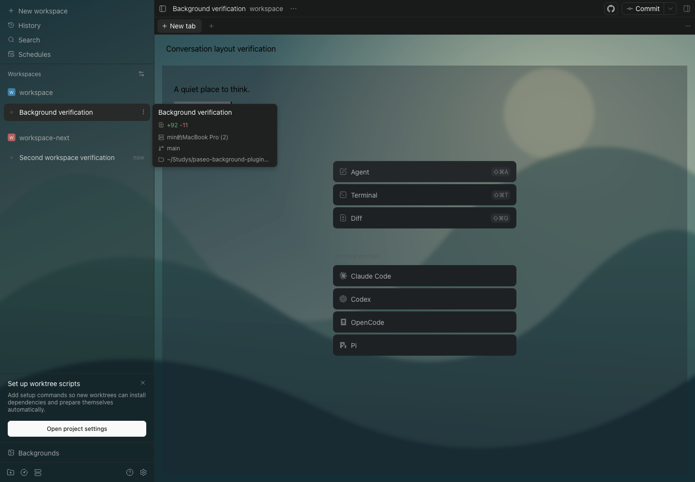
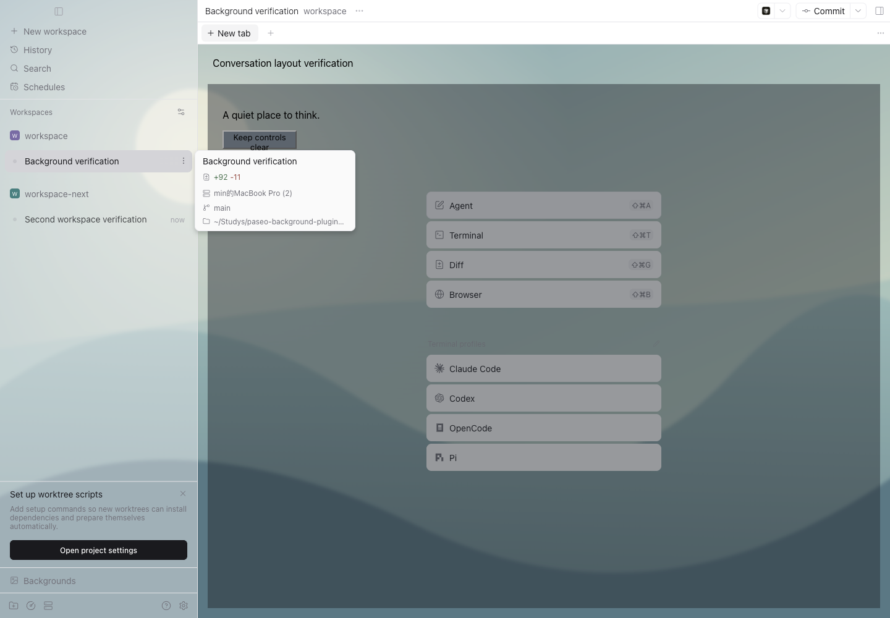

# v0.1.2：聊天区背景合成透明度修复

2026-10-23，Paseo `0.13.0-beta.1`，原版 macOS 桌面及匹配版本 Web UI。

## 实际问题

在用户指定的 `paseo-background-plugins` 和 `help-answer` 两个带会话内容的工作区复现。v0.1.1 的图片层、设置和布局观察器均正常，但标题、工作区、聊天容器各保留了一层 72% 底色：

`1 - (1 - 0.72)³ = 0.978048`

最终遮挡率为 97.8%，侧栏仍能看见背景，聊天区却接近纯色。之前只检查单层是否不透明，无法发现这种错误。日常会话截图保留在本地，没有公开。

## 修复与检查

内层锚点确定了底色后，将已记录的外层底色改为透明。每个区域只保留一次配置中的透明度，不调整文字或控件透明度。

- 嵌套聊天回归在 v0.1.1 失败，修复后通过；同时验证 72%、40% 和重复刷新。
- 类型检查及 17 项回归通过。
- Web 15 组完整流程、原版桌面 8 组完整流程通过，现有工作区切换检查增加最终合成 alpha 上限。
- 两个客户端均在真实工作区中挂载代表已加载聊天的 DOM 布局夹具，验证内层聊天与外层工作区不会重复叠加，控件仍为不透明。夹具不启动 agent、不发送模型请求，完成后清理。

结果：[Web](web-results.json)、[桌面](desktop-results.json)。公开截图仅使用独立测试工作区及合成会话文本。





## 更新

```sh
paseo plugin update paseo-background --ref v0.1.2
```

更新保留背景设置，无需重启 daemon。
