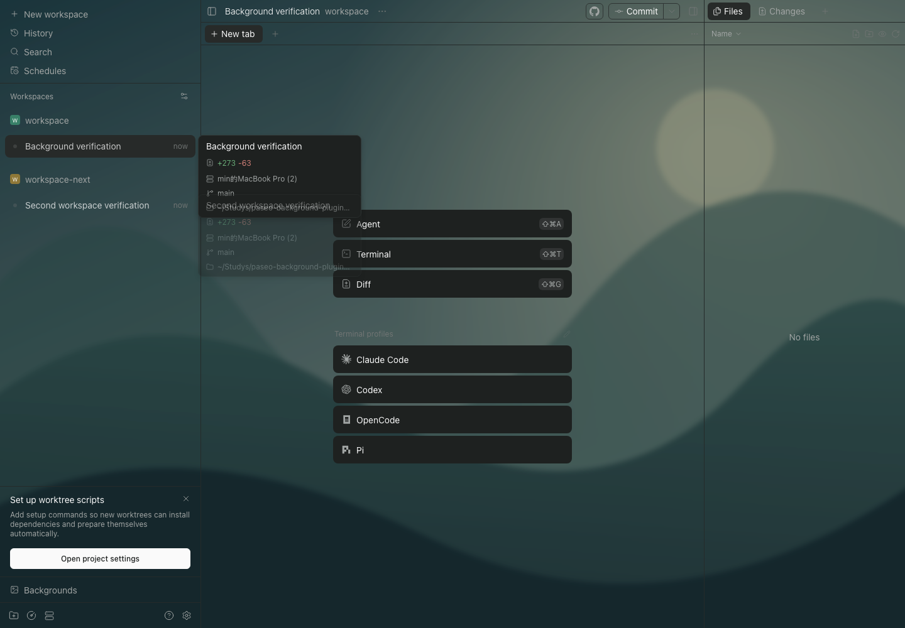
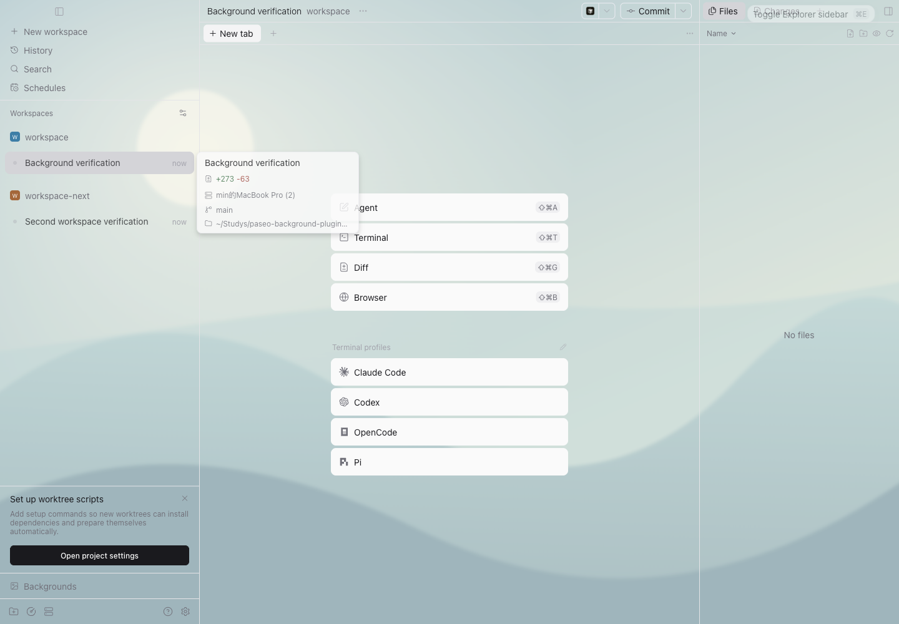

# v0.1.3：切换闪烁与布局覆盖修复

2026-10-23，Paseo `0.13.0-beta.1`，原版 macOS 桌面及匹配版本 Web UI。

## 原因

- v0.1.2 在布局变化后等待 100ms 才适配，切换工作区时可能先绘制原生底色。
- 高度不足 140px 的布局被跳过，36px 的标题栏、标签栏等仍然不透明。
- 右侧 Files / Changes / 插件面板的独立底色未纳入锚点路径。
- 不同区域分别保留底色，聊天、输入框周围与其他区域出现明显分界。

## 实现

用一层固定的主题底色控制界面透明度，已适配的布局背景设为透明，图片与底色层贯穿视口。覆盖输入框外侧的布局，输入框、按钮和面板内的卡片保留原样。

通过 MutationObserver 的微任务检查点，在下一次绘制前完成适配；提前登记隐藏面板的滚动视口，并用 ResizeObserver 处理不伴随属性变更的尺寸变化；保留缓存工作区的标记，复用图片节点，样式规则保持稳定。原版的主题与样式仅在同一任务内测量，停用后完整恢复。

右侧栏支持 Files、Changes，以及 Progress 这类没有固定 DOM 标识的滚动视口。遍历会跨过没有自身尺寸的 `display: contents` 提供者容器，继续检查其可见内容。只适配视口及其布局祖先，不遍历卡片内容；编辑器、终端、画布和文本编辑区作为边界保留。

## 检查

- 类型检查与 **20 项回归**通过。旧版在首帧及短栏覆盖回归中失败。
- **Web 18 组流程**与**原版桌面 11 组流程**通过。
- 逐帧采样快速切换，检查图片节点和可见区域的合成 alpha，没有发现超出配置底色的帧。该检查针对背景适配；不代表宿主其他动画的性能指标。
- 原生 Files / Changes、插件滚动视口、短栏、合成会话与输入区覆盖均通过，控件和卡片保持原底色。
- 深浅主题、预览取消、保存、双客户端同步、修订冲突、图片失败、停用与清理继续通过。

结果：[Web](web-results.json)、[桌面](desktop-results.json)。公开截图来自独立测试工作区，不包含日常会话内容。

在 `paseo-background-plugins` 与 `help-answer` 两个实际会话中，保留原有 HTTPS 地球背景与参数，检查两组 Files / Changes / Progress 共六种面板状态；连续切换的 **126 个渲染帧**均无原底色遮挡，图片节点未替换。另采集 **134 个画面帧**，同一聊天留白点的 RGB 恒为 `(199,199,199)`；旧版同位置在 `(199,199,199)` 与白色 `(255,255,255)` 之间跳变。该结果说明采样位置的白底闪烁已消除，不用于衡量宿主其他内容动画。

刷新恢复通过，背景配置文件哈希与更新前一致，日常 daemon 未重启。去除图片地址、连接信息和会话内容的结果见 [实际工作区记录](real-workspaces.json)；原始会话截图和画面帧仅保留在本地。





```sh
paseo plugin update paseo-background --ref v0.1.3
```
