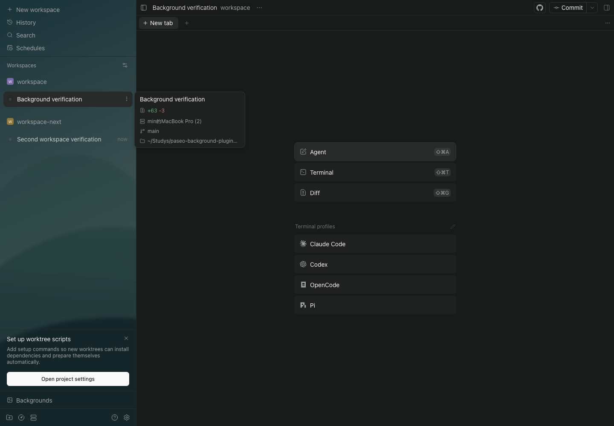
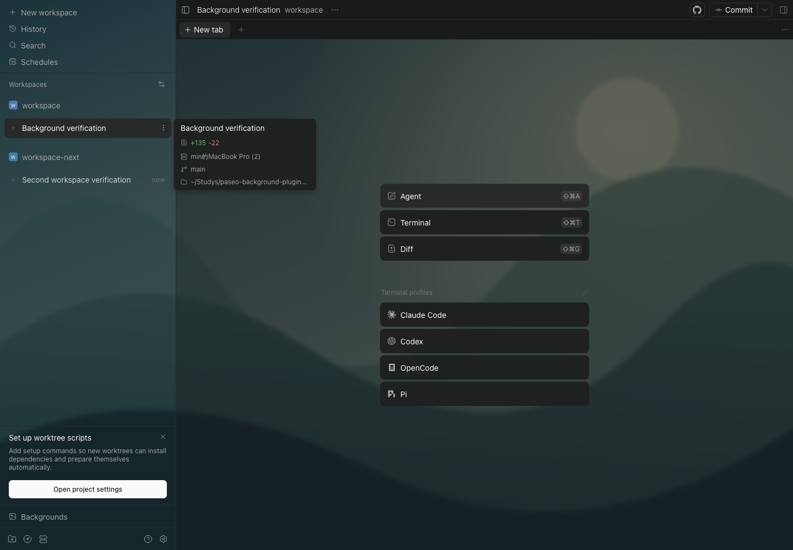

# v0.1.1：workspace 切换后背景失效修复

2026-10-23，Paseo `0.13.0-beta.1`，原版 macOS 桌面（Electron 44.2.0）及同版本 Web UI。

后续发现：本轮检查只排除了完全不透明的祖先，主要切换场景使用空工作区，未覆盖真实聊天中的多层半透明底色叠加。该问题在 v0.1.2 另行修复，见 [聊天区透明度验收](../chat-opacity/README.md)。

## 原因与复现

Paseo 使用 `RetainedPanel` 保留已访问的 workspace，切换时修改外层透明容器的 class / display，不必重新挂载内部内容。v0.1.0 的观察器只关注被修改过底色的节点，而透明容器和隐藏 workspace 不在这些节点中。

从 A 切换到 B 再回到 A 后，图片层仍然存在，但 A 的底色覆盖未重新应用。在独立 daemon 的真实双工作区流程中稳定复现了三个不透明祖先遮挡图片；对应的隐藏 workspace 回归检查在旧实现中失败。



## 修复

将“需要监听的布局祖先”和“实际修改底色的表面”分开记录。所有锚点的祖先，包括透明容器和隐藏 workspace，均参与可见性变化监听；只有当前可见区域应用透明底色。切回缓存工作区后合并一次重算，复用已加载图片。

流式文字和消息行样式变化仍不会触发背景重算；停用后清理两份节点记录、观察器、图片和样式。



## 验证结果

- 严格类型检查和 **16 项回归检查**通过，新增隐藏容器恢复可见的场景。
- **Web 14 组完整流程**通过：两个真实 workspace 五次访问及四次快速切换后，所有可见布局祖先均无不透明遮挡，且仍复用同一个图片节点。
- **原版桌面 7 组完整流程**通过：覆盖首次访问、缓存返回、快速切换、页面刷新、插件关闭和重新启用。
- 原有换图像素检查、参数保存、深浅主题、双客户端同步、修订冲突和错误恢复继续通过；两个客户端完整流程均无未捕获页面异常。

结果文件：[Web](web-results.json)、[桌面](desktop-results.json)。桌面截图：[切换后](desktop-after.png)。所有公开截图均来自独立测试工作区，没有使用日常工作区的会话内容。

运行时复现脚本为 [Web 检查](../../scripts/e2e.mjs)和[桌面检查](../../scripts/desktop-e2e.mjs)。设置 `PASEO_VERIFICATION_DIR` 可指定单独的输出目录，避免覆盖首版验收记录。

## 更新

```sh
paseo plugin update paseo-background --ref v0.1.1
```

更新沿用原有配置，不需要重新选择背景或重启 daemon。
